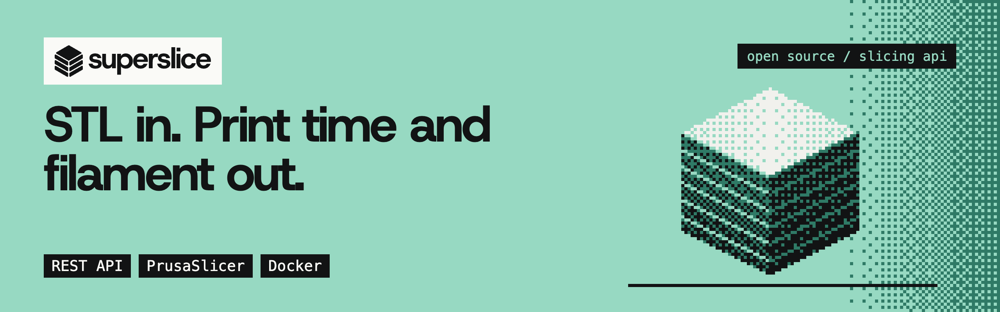

## Hi, I'm Bintang 👋

I build **AI tooling and automation** from Indonesia: MCP servers, LLM-powered pipelines, and developer-friendly APIs. I like turning messy real-world problems into clean APIs and CLIs.

### 🚀 What I'm building

**[superslice](https://github.com/bintangtimurlangit/superslice)**: STL/3MF in, print time & filament usage out, as JSON. Built on PrusaSlicer.

### 🔌 MCP servers

- **[tokopedia-mcp](https://github.com/bintangtimurlangit/tokopedia-mcp)**: search and browse Tokopedia listings.
- **[shopee-mcp](https://github.com/bintangtimurlangit/shopee-mcp)**: explore Shopee listings and prices via an authenticated session.
- **[threads-mcp](https://github.com/bintangtimurlangit/threads-mcp)**: read and manage Threads through an authenticated browser session.
- **[twikit-x-mcp](https://github.com/bintangtimurlangit/twikit-x-mcp)**: full Twitter/X access, no X API key. Built on twikit.
- **[ebay-terapeak-mcp](https://github.com/bintangtimurlangit/ebay-terapeak-mcp)**: search eBay Terapeak sold and active listings through Seller Hub.

---

For more, take a look at my portfolio → **[bintangtimurlangit.me](https://bintangtimurlangit.me/)**
